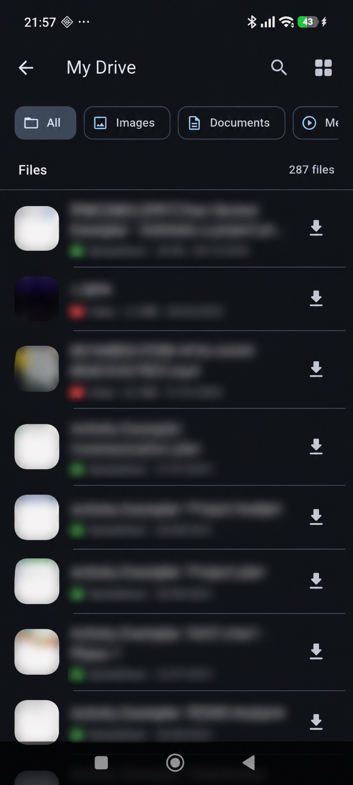
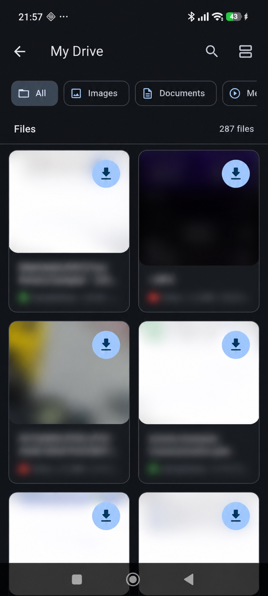
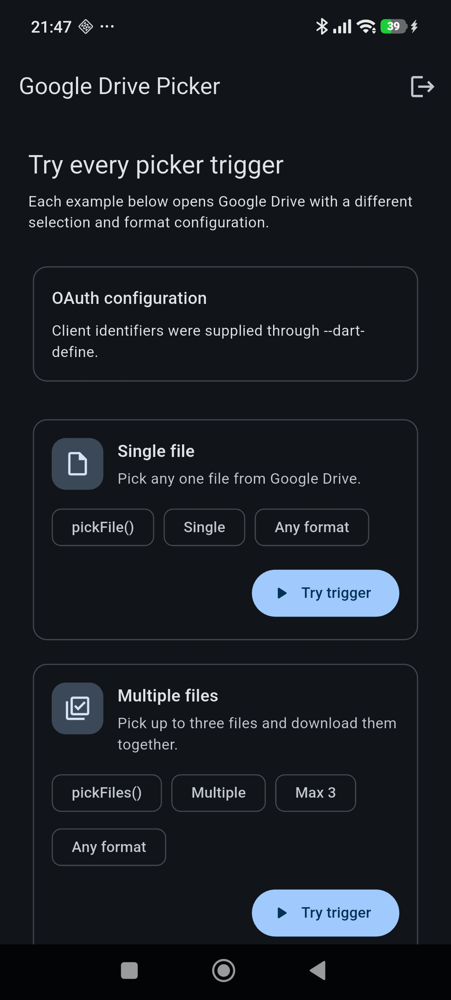
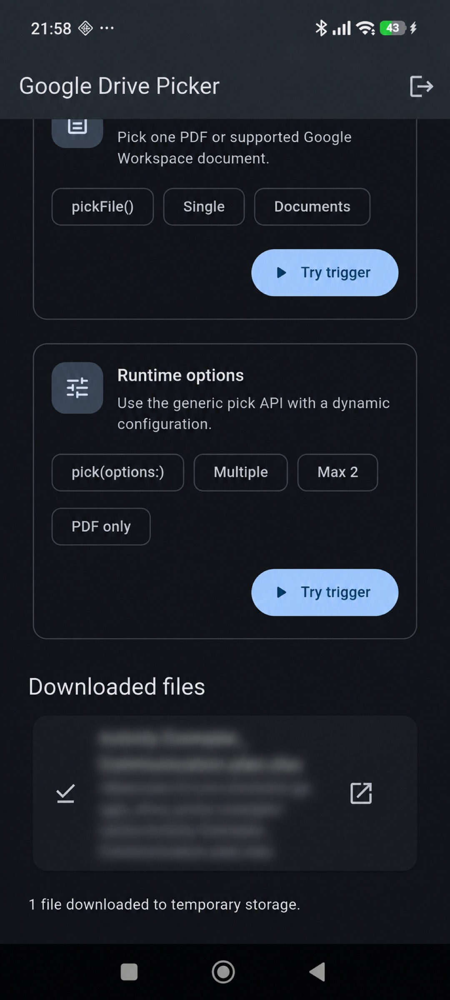

# Google Drive Picker

`google_drive_picker` is a modern Flutter file picker for browsing, searching,
and downloading files from a user's Google Drive.

The package uses Google Sign-In 7 and OAuth directly. It does not require
Firebase Authentication or a Google API key.

## Features

- Read-only Google Drive OAuth authorization
- Paginated listing across My Drive and Shared Drives
- Thumbnail previews with adaptive list/grid views and file-type filters
- Trigger-defined single or multiple selection with maximum-count, extension,
  and exact/wildcard MIME restrictions
- Host light/dark theme inheritance with adaptive confirmation dialogs
- Immediate picker navigation with loading, empty, retry, and error states
- Google Drive shortcut resolution and download-permission checks
- Blob-file downloads and Google Workspace exports:
  - Google Docs → `.docx`
  - Google Sheets → `.xlsx`
  - Google Slides → `.pptx`
  - Google Drawings → `.png`
- Sanitized filenames and temporary-file storage
- Typed service errors and automatic HTTP client cleanup

## Screenshots

| List view | Grid view |
|:---:|:---:|
|  |  |

| Trigger gallery | Download result |
|:---:|:---:|
|  |  |

## Requirements

| Requirement | Minimum |
|---|---:|
| Flutter | 3.29 |
| Dart | 3.7 |
| Android | SDK 21 |
| iOS | 12.0 |
| macOS | 10.15 |

The current API returns a `dart:io` `File`; web is not supported.

## Install

```yaml
dependencies:
  google_drive_picker: ^2.1.0
```

Then run:

```sh
flutter pub get
```

## Values you need

Create these values in the
[Google Cloud console](https://console.cloud.google.com/). OAuth client IDs are
public identifiers, not secrets.

| Target | Create in Google Auth Platform | Used by the app |
|---|---|---|
| Android | Android OAuth client | Registered remotely; not pasted into Dart |
| Android sign-in | Web application OAuth client | `serverClientId` / `GOOGLE_SERVER_CLIENT_ID` |
| iOS | iOS OAuth client | `clientId` / `GIDClientID` |
| iOS callback | Reversed iOS client ID | `CFBundleURLTypes` URL scheme |
| macOS | iOS OAuth client using the macOS bundle ID | Same client-ID and URL-scheme setup as iOS |

You do **not** need:

- A Google API key
- A service-account key
- Firebase Authentication
- An OAuth client secret inside the Flutter application

Never embed a web OAuth client secret, service-account JSON, access token, or
signing private key in the app or repository.

## Google Cloud setup

### 1. Create or select a project

Open the [Google Cloud project selector](https://console.cloud.google.com/projectselector2/home/dashboard)
and create or select the project that will own the OAuth configuration.

Use separate development and production Cloud projects when you need isolated
test users, consent settings, quotas, or credentials.

### 2. Enable the Google Drive API

Open **APIs & Services → Library**, search for **Google Drive API**, open it,
and select **Enable**.

Direct page: [Google Drive API](https://console.cloud.google.com/apis/library/drive.googleapis.com)

Enabling a Drive UI integration or Google Workspace Marketplace listing is not
required for this package.

### 3. Configure Google Auth Platform

Open [Google Auth Platform](https://console.cloud.google.com/auth/overview) for
the selected project and complete:

1. **Branding** — set the application name, support email, logo/domain details
   when applicable, and developer contact email.
2. **Audience** — choose **Internal** for a supported Google Workspace
   organization-only app, or **External** for other Google accounts.
3. **Audience → Test users** — while publishing status is **Testing**, add every
   Google account that should be allowed to sign in.
4. **Data Access → Add or remove scopes** — add:

```text
https://www.googleapis.com/auth/drive.readonly
```

This is the scope requested by the package. It permits viewing and downloading
Drive files but not creating, editing, or deleting them.

Testing-mode authorization is intended for development and can expire, causing
test users to be asked for consent again. Before public release, review the
current Google OAuth verification and restricted-scope requirements.

### 4. Create OAuth clients

Open **Google Auth Platform → Clients**, select **Create client**, and create
the platform clients described below.

Direct page: [OAuth clients](https://console.cloud.google.com/auth/clients)

## Android configuration

### Find the application ID

For the included example it is:

```text
com.immichtv.google_drive_picker.example
```

For another app, read `applicationId` from
`android/app/build.gradle` or `android/app/build.gradle.kts`. Use the exact
value for the build variant being tested.

### Generate signing fingerprints

From the Flutter application's `android` directory run:

```sh
./gradlew signingReport
```

On Windows use:

```powershell
.\gradlew signingReport
```

Under the intended variant, copy its **SHA-1** fingerprint. Register debug,
release, and flavor-specific signing certificates separately when they differ.
For a Play-distributed build using Play App Signing, also register the app
signing certificate shown under **Play Console → Setup → App integrity**; it can
differ from the upload certificate.

### Create the Android OAuth client

In **Google Auth Platform → Clients → Create client**:

1. Select **Android**.
2. Enter a recognizable name.
3. Enter the exact Android package/application ID.
4. Enter the matching SHA-1 fingerprint.
5. Create the client.

Repeat for any package-name/signing-certificate combination not covered by the
first client.

### Create the Web OAuth client used by Android

Create another client with application type **Web application**. Copy its
client ID, which looks like:

```text
123456789012-abcdefghijklmnopqrstuvwxyz.apps.googleusercontent.com
```

Only the client ID is used. Do not put the generated client secret in Flutter.

Pass that web client ID to the example:

```sh
cd example
flutter run \
  --dart-define=GOOGLE_SERVER_CLIENT_ID=YOUR_WEB_OAUTH_CLIENT_ID
```

Alternatively, Android can obtain the web client ID through a properly
configured `google-services.json` and Google Services Gradle integration. That
route does not require Firebase Authentication, but it does require the normal
Google Services setup. The `--dart-define` route is the smallest setup for this
example.

## iOS configuration

### Find the bundle identifier

The included example uses:

```text
com.immichtv.googleDrivePicker.example
```

For another app, open `ios/Runner.xcodeproj` in Xcode and inspect
**Runner target → Signing & Capabilities → Bundle Identifier**, or inspect
`PRODUCT_BUNDLE_IDENTIFIER` in the Xcode project.

### Create the iOS OAuth client

In **Google Auth Platform → Clients → Create client**:

1. Select **iOS**.
2. Enter a recognizable name.
3. Enter the exact bundle identifier.
4. Create the client.
5. Copy the normal client ID and the displayed **iOS URL scheme**. You can also
   download the configuration plist and read `CLIENT_ID` and
   `REVERSED_CLIENT_ID`.

Example normal client ID:

```text
123456789012-abcdefghijklmnopqrstuvwxyz.apps.googleusercontent.com
```

Corresponding reversed client ID / URL scheme:

```text
com.googleusercontent.apps.123456789012-abcdefghijklmnopqrstuvwxyz
```

### Add the URL scheme

Add the reversed OAuth client ID as a URL scheme in `Info.plist`:

```xml
<key>CFBundleURLTypes</key>
<array>
  <dict>
    <key>CFBundleTypeRole</key>
    <string>Editor</string>
    <key>CFBundleURLSchemes</key>
    <array>
      <string>YOUR_REVERSED_CLIENT_ID</string>
    </array>
  </dict>
</array>
```

For the example, replace `YOUR_REVERSED_CLIENT_ID` in
`example/ios/Runner/Info.plist`.

### Supply the normal iOS client ID

Choose either configuration method.

Method A — pass it when running the example:

```sh
cd example
flutter run \
  --dart-define=GOOGLE_CLIENT_ID=YOUR_IOS_OAUTH_CLIENT_ID
```

Method B — add it to `ios/Runner/Info.plist`:

```xml
<key>GIDClientID</key>
<string>YOUR_IOS_OAUTH_CLIENT_ID</string>
```

Then initialize without an explicit `clientId`. The reversed URL scheme is
required for both methods so Google can return to the application after
authentication.

## macOS configuration

Create an **iOS** OAuth client using the macOS bundle identifier, then apply the
same `GIDClientID` and reversed URL scheme configuration to
`macos/Runner/Info.plist`.

Google Sign-In on macOS also requires keychain sharing. Add the access group
required by the current `google_sign_in_ios` integration documentation to the
Runner entitlements. This repository's example currently contains Android and
iOS targets only.

## Run the included example

Install packages:

```sh
flutter pub get
cd example
flutter pub get
```

List available devices:

```sh
flutter devices
```

Run Android:

```sh
flutter run \
  -d YOUR_ANDROID_DEVICE_ID \
  --dart-define=GOOGLE_SERVER_CLIENT_ID=YOUR_WEB_OAUTH_CLIENT_ID
```

Run iOS:

```sh
flutter run \
  -d YOUR_IOS_DEVICE_OR_SIMULATOR_ID \
  --dart-define=GOOGLE_CLIENT_ID=YOUR_IOS_OAUTH_CLIENT_ID
```

If identifiers are already supplied through native configuration, omit their
corresponding `--dart-define` arguments.

## Usage

Initialize once before `runApp`. Platform configuration can provide the client
identifiers, so both arguments are optional:

```dart
import 'dart:io';

import 'package:flutter/material.dart';
import 'package:google_drive_picker/google_drive_picker.dart';

Future<void> main() async {
  WidgetsFlutterBinding.ensureInitialized();

  await GoogleDrivePicker.instance.initialize(
    clientId: optionalIosClientId,
    serverClientId: optionalWebClientId,
  );

  runApp(const MyApp());
}
```

When supporting both Android and Apple platforms from one codebase, only pass
the Apple client ID on iOS/macOS:

```dart
await GoogleDrivePicker.instance.initialize(
  clientId: (Platform.isIOS || Platform.isMacOS) ? iosClientId : null,
  serverClientId: webClientId,
);
```

The included example performs this platform check automatically for its
`GOOGLE_CLIENT_ID` value.

Open the picker from a user interaction:

```dart
final File? file = await GoogleDrivePicker.instance.pickFile(
  context: context,
);

if (file != null) {
  // Open it, inspect it, or copy it to permanent application storage.
  debugPrint(file.path);
}
```

### Configure each picker trigger

The caller controls selection behavior for every invocation. Use `pickFile`
for a single result, `pickFiles` for multiple results, or `pick` with a
`GoogleDrivePickerOptions` object when the configuration is chosen at runtime.
The picker applies those constraints before showing files, so users can only
select valid results.

Restrict a single-file picker by extension and/or MIME type:

```dart
final File? document = await GoogleDrivePicker.instance.pickFile(
  context: context,
  allowedExtensions: const <String>{'pdf', 'docx'},
  allowedMimeTypes: const <String>{
    'application/pdf',
    'application/vnd.google-apps.document',
  },
);
```

Allow multiple selection and enforce a maximum count:

```dart
final List<File>? images = await GoogleDrivePicker.instance.pickFiles(
  context: context,
  maxFiles: 5,
  allowedExtensions: const <String>{'jpg', 'jpeg', 'png', 'webp'},
  allowedMimeTypes: const <String>{'image/*'},
);

if (images != null) {
  for (final File image in images) {
    debugPrint(image.path);
  }
}
```

Format matching is case-insensitive. Extensions may include a leading dot,
and MIME types support category wildcards such as `image/*` and `video/*`.
When extension and MIME allowlists are both provided, a file is shown when it
matches either list. Google Docs, Sheets, Slides, and Drawings also match their
export extensions (`docx`, `xlsx`, `pptx`, and `png`). Omit `maxFiles` to allow
any number of selections.

For a selection mode chosen at runtime, use `pick(...)` with a
`GoogleDrivePickerOptions` object. It always returns `List<File>?`:

```dart
final List<File>? files = await GoogleDrivePicker.instance.pick(
  context: context,
  options: GoogleDrivePickerOptions(
    allowMultiple: shouldAllowMultiple,
    maxFiles: shouldAllowMultiple ? 3 : null,
    allowedExtensions: const <String>{'pdf'},
  ),
);
```

Sign out when your application needs to end the Google session:

```dart
await GoogleDrivePicker.instance.signOut();
```

## File lifecycle

Returned files are written to the platform temporary directory. The operating
system may delete them at any time. Copy them to application documents or
other permanent storage if they must survive cache cleanup.

An existing temporary file with the same name may be replaced by a later
download.

## Errors and cancellation

- Cancelling Google Sign-In or closing the picker returns `null`.
- `pickFile` returns `File?`; `pickFiles` and `pick` return `List<File>?`.
- `GoogleDriveAuthorizationException` indicates that Drive authorization was
  not available.
- `GoogleDriveFileException` covers unsupported exports, missing metadata, and
  files the user cannot download.
- Other Google Sign-In, Drive API, network, and filesystem failures propagate
  to the caller.

Wrap picker calls in `try`/`catch` and present an appropriate retry action.

## Production release checklist

- Replace the sample package and bundle identifiers with identifiers owned by
  your application.
- Use production OAuth clients that exactly match those identifiers.
- Register Android debug, upload, and Play App Signing certificates as
  applicable.
- Move the Google Auth Platform audience out of Testing when appropriate.
- Complete brand/OAuth verification required for the selected audience and
  Drive scope.
- Provide verified homepage, privacy-policy, and terms URLs when requested by
  Google Auth Platform.
- Test release builds; debug credentials do not automatically authorize a
  differently signed release build.
- Verify sign-in with an account that is not a project owner.
- Review Drive API quotas and error reporting in the production Cloud project.
- Never log authorization headers, access tokens, or downloaded user content.

## Official configuration references

- [Google Auth Platform OAuth clients](https://support.google.com/cloud/answer/15549257)
- [Google OAuth app verification](https://support.google.com/cloud/answer/13461325)
- [Google Drive API scopes](https://developers.google.com/workspace/drive/api/guides/api-specific-auth)
- [Google Sign-In for Android](https://pub.dev/packages/google_sign_in_android#integration)
- [Google Sign-In for iOS and macOS](https://pub.dev/packages/google_sign_in_ios#ios-integration)

## Migration and support

- [Migration guide from 1.x](https://github.com/WorkWithAfridi/google_drive_picker/blob/google_drive_picker/MIGRATION.md)
- [Troubleshooting guide](https://github.com/WorkWithAfridi/google_drive_picker/blob/google_drive_picker/TROUBLESHOOTING.md)
- [Complete example](https://github.com/WorkWithAfridi/google_drive_picker/blob/google_drive_picker/example/README.md)
- [Changelog](https://github.com/WorkWithAfridi/google_drive_picker/blob/google_drive_picker/CHANGELOG.md)

The deprecated `setAPIKey` method is a no-op retained only for short-term source
compatibility. New code should not call it.
